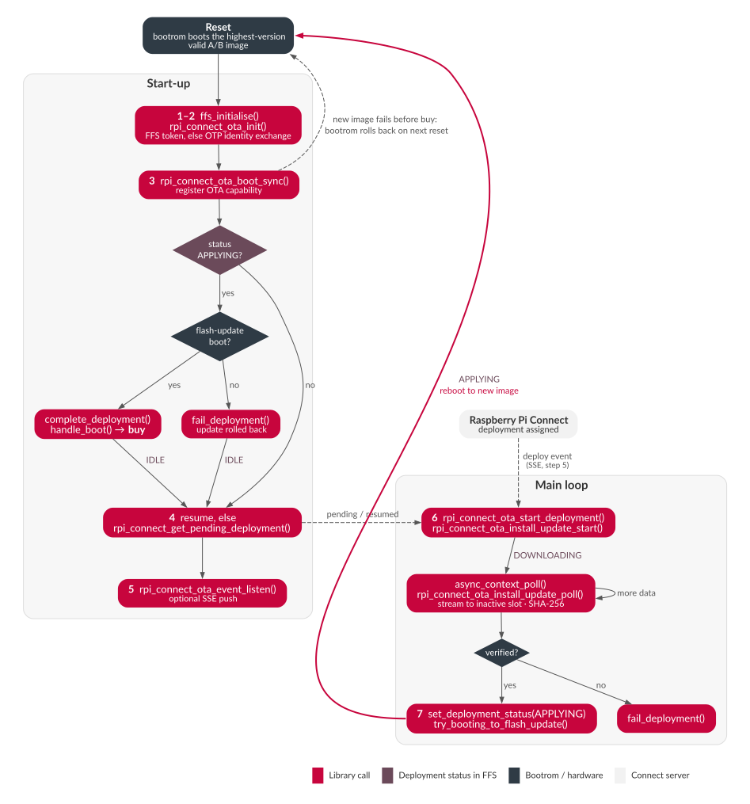

# API walkthrough

[← Back to the overview](../README.md)

The example drives the `pico_rpi_connect` and `pico_rpi_connect_ota` APIs (see
`pico/rpi_connect_ota.h`) in a fixed order. The library owns the deployment state
machine; `main_pico.c` does the bring-up and `rpi_connect_ota_demo.c` shows how
an application main loop integrates it.

## Call sequence

| Step | Call(s)                                                                                 | When          |
|------|-----------------------------------------------------------------------------------------|---------------|
| 1    | `ffs_initialise()`                                                                      | Boot          |
| 2    | `rpi_connect_ota_init()`                                                                | Boot          |
| 3    | `rpi_connect_ota_boot_sync()`                                                           | Boot, once    |
| 4    | `rpi_connect_ota_get_resumable_deployment_id()`, `rpi_connect_ota_resume_deployment()`, `rpi_connect_get_pending_deployment()` | Boot |
| 5    | `rpi_connect_ota_event_listen()` (optional)                                             | Boot          |
| 6    | `rpi_connect_ota_start_deployment()`, `rpi_connect_ota_install_update_start()`, `..._poll()` | On deployment |
| 7    | `rpi_connect_ota_set_deployment_status(APPLYING)`, `rpi_connect_ota_try_booting_to_flash_update()` | Download verified |

### 1. Storage — `ffs_initialise()`

FFS holds the cached access token (file id `0x1`), the WiFi credentials
(`0x10`/`0x11`) and the in-progress deployment state (`0x2`–`0x5`).

### 2. Sign in — `rpi_connect_ota_init()`

Obtains an access token, using the first of:

1. a token in FFS (cached, or provisioned);
2. a build-time PEM identity key (debug only);
3. the OTP identity key, via a signed device-identity exchange.

A newly exchanged token is cached in FFS. Retrieve it with
`rpi_connect_ota_get_auth_token()`.

### 3. Boot sync — `rpi_connect_ota_boot_sync()`

Called once after sign-in. It:

1. Registers the OTA capability (`rpi_connect_ota_register_ota_capability()`) —
   the first authenticated round-trip to the server, which gates everything
   below.
2. Reports the outcome of the previous deployment, if one was being applied
   (see [Deployment lifecycle](#deployment-lifecycle)).
3. Calls `rpi_connect_ota_handle_boot()` to issue the bootrom **explicit buy**,
   committing a freshly flashed image.

If the success report cannot be delivered, the buy is skipped and an error is
returned, so the bootrom rolls back on the next reset.

A return of `-401` means the cached token was rejected. Outside a
try-before-you-buy boot, the demo deletes the token from FFS and reboots, so the
next boot repeats step 2 with a fresh identity exchange.

### 4. Catch up — resume or pending deployment

`rpi_connect_ota_get_resumable_deployment_id()` checks FFS for a download that
was interrupted by a reboot; `rpi_connect_ota_resume_deployment()` re-fetches its
URI and checksum and restarts it.

If nothing is being resumed, `rpi_connect_get_pending_deployment()` asks the
server for a deployment assigned while the device was offline (the event stream
does not replay these). A pending deployment is started exactly like a pushed
one.

### 5. Listen — `rpi_connect_ota_event_listen()`

Opens a persistent SSE connection so the deploy callback fires as soon as the
server assigns a deployment. This is optional: build with
`RPI_CONNECT_OTA_DEMO_POLL_ONLY=1` (see `CMakeLists.txt`) to skip it on metered
connections, and rely on step 4 at the next boot instead.

### 6. Download — `rpi_connect_ota_start_deployment()` → `rpi_connect_ota_install_update_start()`

`start_deployment` returns the firmware URI and expected checksum, and sets the
status to `DOWNLOADING`. `install_update_start` streams the image straight into
the inactive A/B slot, hashing it as it goes. Drive it from the main loop:

```c
async_context_poll(rpi_connect_default_async_context());
rc = rpi_connect_ota_install_update_poll(update_ctx, &result);
// progress: rpi_connect_ota_install_update_bytes_so_far(update_ctx)
```

### 7. Apply — `rpi_connect_ota_set_deployment_status(APPLYING)` → `rpi_connect_ota_try_booting_to_flash_update()`

On a verified download, mark the deployment `APPLYING` (persisted in FFS) and
reboot into the new slot. Success is **not** reported here — that happens in
step 3 after the reboot. On a failed download, call
`rpi_connect_ota_fail_deployment()` instead.

---

## Deployment lifecycle



The deployment status is persisted in FFS (`RPI_CONNECT_FFS_DEPLOYMENT_STATUS`)
and moves `IDLE` → `DOWNLOADING` → `APPLYING` → `IDLE`. The diagram source is
`ota-lifecycle.dot`; regenerate with `dot -Tsvg ota-lifecycle.dot -o ota-lifecycle.svg`.

On boot, with status `APPLYING`, boot sync checks how the device started
(`rpi_connect_ota_boot_is_flash_update()`):

| Boot type         | Meaning                                                          | Action                                        |
|-------------------|------------------------------------------------------------------|-----------------------------------------------|
| Flash-update boot | Running the new image, which has signed in and reached the API   | `rpi_connect_ota_complete_deployment()`, then buy |
| Normal boot       | The new image never ran, or failed and the bootrom rolled back   | `rpi_connect_ota_fail_deployment()` so the server can re-deploy |

Deferring both the success report and the buy until the new image has proven it
can reach the API is the anti-brick safety net: an image that crashes, cannot
join the network or cannot authenticate is never committed or reported as
successful, and the bootrom returns to the previous image on the next reset.

A status of `DOWNLOADING` (or any other non-`APPLYING` status with a stored
deployment id) is resumable and is handled in step 4.

## Download verification

Downloads use TLS, with the artefact host's certificate verified against the
Pi Connect root CA. If your artefacts are hosted elsewhere (for example
third-party object storage), build with
`RPI_CONNECT_OTA_DEMO_UNVERIFIED_DOWNLOAD=1`: the download is still encrypted
but the host is not authenticated, so integrity rests on the deployment's
SHA-256 checksum, which is always required and verified. API requests are always
verified against the Pi Connect root CA.
